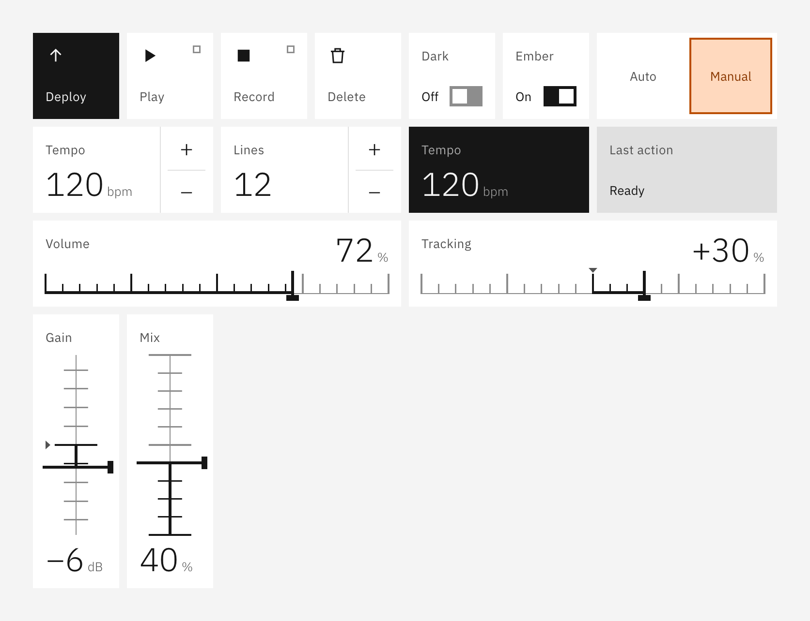

# Molette

Controls designed to be shown. Sliders, steppers, toggles and keys for creative coding: square cells on a golden-ratio grid, with hard edges, built to sit around your sketch instead of floating over it.

A *molette* is the ridged thumbwheel you roll to fine-tune something.



## Use it

```bash
npm install molette
```

```tsx
import { Grid, Key, Toggle, Stepper, Slider, Tape, Wheel } from 'molette';
import 'molette/styles.css';

<Grid scale="m" cols={8}>
  <Key mode="latch" process label="Play" onLabel="Playing" />
  <Toggle label="Outline" defaultChecked />
  <Stepper label="Size" unit="px" min={8} max={400} defaultValue={120} />
  <Slider label="Tracking" unit="%" min={-100} max={100} defaultValue={0} w={4} onValueChange={setTracking} />
</Grid>
```

Molette is React components today (React 18 or 19). Feed the values into your p5.js, Canvas or WebGL sketch from `onValueChange`.

Browsers: Chrome and Edge 111+, Safari 16.2+, Firefox 121+ (all released in 2023). The CSS relies on `:has()`, `color-mix()`, `oklch()` and container queries.

Molette has no font of its own: controls inherit the font of the page they sit on, like plain text. To give a board a different one, set `font-family` on any ancestor, or `<Theme tokens={{ 'font-sans': 'Inter, sans-serif' }}>`.

### Theming

Wrap a board, a panel or the whole app in `Theme`. Themes nest; the innermost setting wins.

```tsx
<Theme appearance="auto" accent="teal" marks="accent" radius="s">
  <Grid>…</Grid>
</Theme>
```

| Prop | Values | Default |
|---|---|---|
| `appearance` | `light` · `dark` · `auto` (follows the system) | inherited, light at the root |
| `accent` | `orange` `red` `magenta` `purple` `blue` `cyan` `teal` `green` `yellow` `ink`, or any CSS colour | `orange` |
| `marks` | `ink` · `accent`: the colour of fills, lit ticks, thumbs, switches and pads | `ink` |
| `radius` | `none` · `s` · `m` · `l`, or a fraction of the cell (`0.08`) | `none` (hard edges) |
| `scale` | `xs` · `s` · `m` · `l` · `xl` | `m` |
| `tokens` | any token by name: `{ ground: '#0b0b0b', 'font-sans': 'Inter' }` | |

From one accent colour, Molette mixes the rest (selection tint, its text and edge, accent text, the ink on an accent fill) against the theme's cell and ink, so any colour works in light and dark.
Every control also takes its own `accent`, which colours its marks and selection: `<Toggle label="Rec" accent="red" />`.

Under the hood it is all CSS variables prefixed `--mo-` (`--mo-ink`, `--mo-accent`, `--mo-cell-m`…), so plain CSS works too: set them on any ancestor, or put `data-theme="dark"` on one.
The bundle is marked `'use client'`, so it works from Next.js App Router server components.

## Components

| Component | What it is | Main props |
|---|---|---|
| `Grid` | Optional board layout | `scale` xs·s·m·l·xl, `cols` (a number or `auto`), `fluid` |
| `Cell` + `Readout` | A plain cell / label-value-unit | `tone` default·sunk·inverse·accent·slot |
| `Key` | A cell you press | `mode` momentary·latch·hold, `process` + `onLabel`, `undoMs`, `short` |
| `Toggle` | On/off switch, or a two-option radio group | `label` or `pair={['Auto','Manual']}`, `short` for the pair |
| `Stepper` | Spinbutton: value with −/+ in one cell | `min max step unit`, `onValueCommit` |
| `Slider` | A ruler that slides under a centred, footed thumb | `min max step unit origin orient`, `onValueCommit` (drag end, keys, wheel, reset) |
| `Tape` | Slider, bare: ticks and a thin bar, no baseline or fill bar | same as `Slider` |
| `Wheel` | Tape's ticks on a turning wheel under a needle (horizontal only) | same as `Slider`, no `orient` |

Every component takes `w h` (size in cells), optional `x y` (fixed placement in a Grid) and optional `scale`.

`Grid` is optional. Outside one, a control sizes itself from `w h` at its scale, so you can drop it into any flex row or form:

```tsx
<div style={{ display: 'flex', gap: 8 }}>
  <Key label="Save" scale="s" onPress={save} />
  <Slider label="Opacity" unit="%" scale="s" w={4} />
</div>
```

Scale comes from the control's own `scale`, else the nearest ancestor with `data-scale` (a Grid sets one), else `m`.

### Responsive boards

The five scales are presets on one continuous scale: padding, label and value sizes all derive from the cell size, so a cell of any size lays out the same way.

- **`fluid`** stretches the grid to its container and everything inside the cells scales with them. If cells get smaller than about 44px they go dense, like `xs`: labels hide and content centres.
- **`cols="auto"`** picks 13, 8 or 5 columns (the `--mo-cols-wide/regular/compact` tokens), whichever is the most that fit, so the same board works on a desktop and a phone. Cells flow in order (`x`/`y` are ignored) and a cell wider than the grid is cut to fit. With `fluid`, `scale` is the smallest cell the grid allows before it drops columns.

```tsx
<Grid cols="auto" fluid scale="s">…</Grid>
```

- **Text is never cut off.** There is no ellipsis anywhere: every label, word and value has a chain of fallbacks that ends in something that fits.
  - **Key:** `onLabel` → `label` → `short` → the icon alone, with the label as its tooltip. Without an icon: generated forms, down to one letter ("Settings" → "Set" → "S").
  - **Pair:** both words step down together: `short`, then generated forms ("Aut" / "Man").
  - **Stepper, Toggle, Slider, Tape, Wheel, Readout labels:** first word, then first three letters, then hidden (a control's label becomes its tooltip).
  - **Values:** drop the unit, then large numbers go compact (14400 → "14.4K"), then the value steps down to 0.8 and 0.618 of its size.
  - The accessible name never changes. Whenever a generated form is used, or a value can't fit even at its smallest, Molette warns in the console during development, naming the label, so you can give it a `short` form or a wider cell before it ships.

```tsx
<Key label="Save" short="Sv" />
<Toggle pair={['Auto', 'Manual']} short={['Au', 'Man']} label="Mode" />
```

- **Dense cells.** At `xs` (or a fluid grid squeezed under ~44px), a 1×1 cell shows one centred thing: an icon, a short label, a value. A cell 2 or more wide lays out in a row, like a button: label on the left, icon or value on the right. Labels hold 12px. The switch drops its state word for a bigger slot with a check on the thumb when on. A Stepper's top and bottom halves become the + and − targets across the whole cell.
- **Touch:** on a touch screen (`pointer: coarse`), `xs` becomes `s`, since 34px cells are too small for fingers. Put `className="mo-keep-xs"` on the control or an ancestor to keep `xs`.
Any other HTML attribute (`id`, `data-*`, `aria-*`, event handlers) passes through to the element; your handlers run before the built-in ones, and `preventDefault()` skips ours.
Values work controlled (`value` + `onValueChange`) or uncontrolled (`defaultValue`).

Every control shows numbers by the same rules: decimals follow `step` (step `0.01` shows `137.51`), negatives take a true minus (`−6`), and on a range that crosses zero, positives take a `+` (`+12`). Digits are tabular, so they don't jitter while dragging.

Slider, Tape and Wheel share one engine and follow one rule: a press never changes a value, a gesture does, so you can touch the board while a sketch runs.
The scale is longer than the cell and moves under a fixed thumb (Wheel: the scale turns), so you always see the ticks around the value.

- **Drag** anywhere on the control to pull the scale: it moves as far as the pointer moves, so dragging right brings lower values to the thumb.
- **Click** (released within 250 ms, without moving) brings the clicked tick to the thumb.
- **Weight**: let go mid-drag and the scale coasts on, slowing to a stop, like a real tape or flywheel. A press catches it; Escape or any key stops it. `onValueCommit` fires once, when it comes to rest. `inertia={false}` turns it off; it is also off under reduced motion.
- **Fine control**: while dragging, move away from the slider. 34 px away it slows to ×¼, 89 px away to ×1/16, and the label says so. Shift slows it a further ×¼.
- **Touch**: a swipe across a slider scrolls the page; the slider takes only swipes along its own axis.
- **Wheel and trackpad** (only while the slider has focus): a trackpad moves the thumb as far as your fingers move; a mouse-wheel notch moves one step (Shift: ×10). `onValueCommit` fires once when the gesture stops, not on every event.
- **Keys**: arrows step (Shift: ×10), Home and End, Delete resets. Double-click resets. Escape cancels a drag.

The other controls:

- **Stepper**: the cell itself is the spinbutton and takes the same keys as a slider. Press and hold − or + to repeat: one step at once, then after 400 ms a step every 60 ms. The − and + buttons never take focus, so reaching a limit never drops it.
- **Key, hold mode**: Space and Enter can be held as well as the pointer. With `undoMs`, a confirmed key becomes `Undo · 3s` and counts down; pressing it calls `onUndo`.
- **Toggle pair**: arrow keys move between the two words and select, like any radio group. The `ref` is the group's `<div>`; for a plain switch it is the `<button>`.

Motion follows three rules: it runs only along the control's own axis, it never bounces, and every duration is a token (`--mo-t-press` 70 ms, `--mo-t-tick` 110 ms, `--mo-t-travel` 240 ms, `--mo-t-reflow` 400 ms). Reduced motion turns it all off.

- **Press**: a key is pushed into the board. Its surface goes one level deeper and its content drops 1 px; nothing scales, so the grid's gaps never move.
- **Travel**: on a jump (click, key, reset, wheel notch) the thumb and fill travel, and each tick lights as the thumb passes it, like an LED meter. While you drag, everything follows the pointer instantly.
- **End stop**: pushing past min or max compresses the thumb's foot and flashes that end of the ruler.
- **Change**: while you drag, the label shows how far you have moved (`+12`, or `Fine ×¼ · +3`), and keeps it for 400 ms after release.
- **Focus**: in a Grid, keyboard focus is one ring that slides from cell to cell. A pointer press hides it; any key brings it back.
- **Rolling digits**: on a discrete change (key, click, reset, wheel notch, Stepper button), only the digits that changed roll, up when the value grew. Values you drag, or that your code drives, change in place.
- **Hover preview**: a hovering mouse shows a hollow ghost thumb where a click would land, and the label previews the value (`→ 64 %`).
- **Hold to confirm**: let go early and the fill drains back; complete the hold and the full fill flashes once before Undo appears.

The slider's ruler has one form per part: ticks at round values of the range (1, 2, 2.5 or 5 × 10ⁿ, taller every 5), a fill from the origin to the value, a small triangle marking the origin when it isn't the minimum (zero on a bipolar range, or whatever you pass as `origin`), and the thumb, the only mark with a foot.

## Accessibility

- **Real roles.** Slider, Tape and Wheel are `slider`s (with `aria-valuetext`, unit included), Stepper is a `spinbutton`, a Toggle is a `switch` or a `radiogroup` of two `radio`s, a latch Key is a `button` with `aria-pressed`.
- **Everything works from the keyboard**, including hold-to-confirm (hold Space or Enter). See the keys listed above.
- **The accessible name never changes.** When a label is shortened or hidden to fit, screen readers still hear the full label.
- **Focus rings for keyboard users only.** A pointer press hides the ring; the next key brings it back.
- **`help`** becomes the control's tooltip and its `aria-describedby` description. Hold keys add "Press and hold to confirm" on their own, and the Undo countdown is announced politely.
- **Reduced motion** turns off every animation, including Slider inertia.
- **Touch targets**: on a touch screen, `xs` cells grow to `s` (55 px).

## Develop

```bash
npm install
npm run dev     # demo board at localhost:5173
npm test        # behaviour tests
npm run lint    # oxlint, with the React hooks rules
npm run build   # dist/ : ESM, CJS, types, styles.css
```

`src/styles.css` is the published Molette CSS (tokens + components). The React code adds no styles; change the look there.
